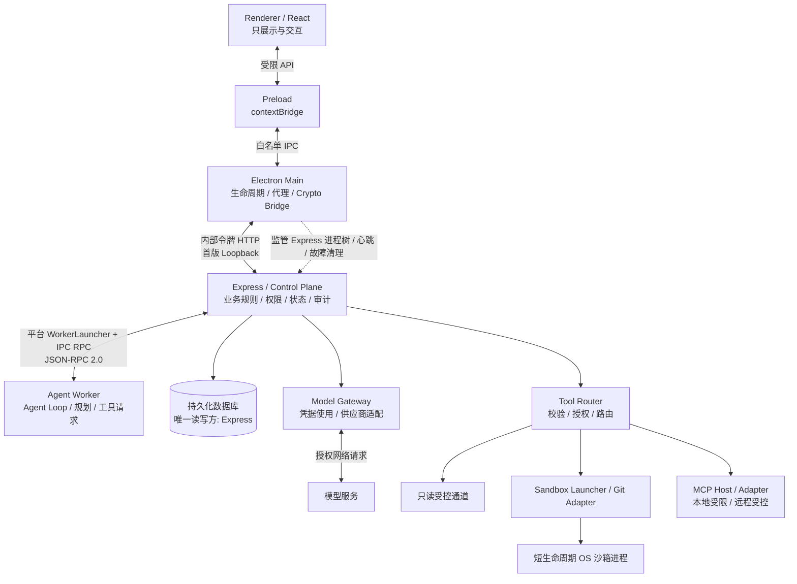

# ARCHITECTURE.md — Electron Agent Desktop

> 状态：**P0 架构决策已批准；平台实现与安全能力仍待逐项验证**  
> 版本：`0.4.0-p0`  
> 日期：2026-10-24  
> 适用范围：Electron + TypeScript + React + Express + Node.js Agent Worker  
> 依据：ADR-001～ADR-015 及已批准 ADR-WIN-001 r1；后者仅修改 Windows Worker 创建、IPC、资格门禁和相关阶段约束。
> 选型状态：P0 基线已具体化；实现与平台安全性仍待验证，非已上线证明

## 0. 文档目的与规范性

本文件定义桌面 Agent 产品 V1 的**架构边界、可信执行路径、进程职责、失败语义和验收标准**。它是新仓库的目标架构，不描述旧项目的实际实现，也不允许以“旧代码已经这样做”为理由破坏本文约束。

规则用语：

- **MUST / 必须**：不可违反；PR 和 CI 应有检查或测试。
- **MUST NOT / 禁止**：任何代码路径不得触发。
- **SHOULD / 应当**：默认执行；例外必须记录原因。
- **DEFERRED / 暂缓**：并非 V1 实施前提，不能暗自假定已经实现。

文档区分**已冻结的 V1 设计选型**、**平台实现候选**、**通过测试才能声明有效的安全属性**。P0 决定技术路线不等于已完成平台验证。

## 1. 目标、非目标与威胁假设

### 1.1 V1 目标

1. 构建可安装、可运行、可调试、可测试的跨平台 Electron Agent 桌面应用架构。
2. 完成**单 Agent 闭环**：用户发起任务 → 模型推理 → 提交工具请求 → 授权 → 受限执行 → 流式反馈 → 持久化结果。
3. 统一业务控制面：UI、CLI（后续可接入）和 Agent 工具调用复用同一套 Express 领域规则、鉴权、校验和审计。
4. 高风险工具受到 OS 原生隔离；故障时 Fail-Closed，不能因审批、提示词或进程重启而绕过约束。
5. 先搭干净骨架、用架构门禁验证，再按可迁移能力逐项迁入，不移植旧的耦合关系。

### 1.2 V1 非目标

首版不要求 Multi-Agent 编排、长期语义记忆、复杂自动检查点恢复、插件市场、多人协作、云同步、远程 Executor、跨语言 Worker、Git Worktree 并行隔离及大规模分布式扩缩容。

### 1.3 信任边界

- **不可信**：用户打开的工作区文件、模型输出、网页与检索内容、MCP 工具描述/结果、第三方 MCP Server、Renderer 收到的任意数据。
- **有限可信**：Renderer 和 Preload（仍可能受 XSS / 供应链问题影响）；Agent Worker（必须按可被提示注入或依赖漏洞影响来设计）。
- **受信控制面**：Express 的身份、策略、审批、状态和路由模块；应尽量缩小其依赖与权限。
- **操作系统最终边界**：文件、进程、网络权限由 OS 强制约束；TypeScript 类型、UI 确认弹窗、提示词不是安全隔离机制。
- **残余风险**：不能声称阻止同一用户账户下的全部本地恶意软件、内核漏洞或用户自己批准的危险业务行为。远程 MCP 的副作用也不能受本地沙箱直接约束。

## 2. 总体拓扑与进程模型



**Main ↔ Express 的箭头同时承载白名单 API 代理及受限 Crypto Bridge 内部 RPC，二者使用不同的身份/能力范围；图不表示两者共享无差别授权。**

**“四层”是逻辑分层，不是“只有四个 OS 进程”。** V1 的核心进程角色为 Electron Main、Renderer、Express、Agent Worker；Preload 依附于渲染器的隔离上下文。高危工具以短生命周期子进程运行。**Express 是 Worker 的直接父进程**；Main 负责监管 Express 所在的服务进程树，而不是直接创建/单独管理 Worker。**不设置常驻通用 Tool Executor**。

**Windows 创建/通信规范**：Express 进程内原生 WorkerLauncher + 单条受保护的继承 Win32 管道 + OWIP/1 framing / JSON-RPC 2.0，详见 [ADR-WIN-001 r1](docs/adr/ADR-WIN-001.md)。其他 OS 暂保留 fork + Node IPC 适配器；任何平台未满足 Worker Gate 都不得启用生产 Worker。

### 2.1 职责所有权表

| 组件 | 唯一允许的主要职责 | 明确禁止 |
|---|---|---|
| Electron Main | 窗口、生命周期、启动/监管 Express **整棵进程树**、健康探测、受限 API 转发、`safeStorage` Crypto Bridge | 直接启动/经营 Worker 业务、Agent 推理循环、领域权限决策、任务数据库写入、直接实现工具业务 |
| Preload | 暴露窄接口、校验传入参数的基本形状、桥接白名单 IPC | 暴露 `ipcRenderer` 原始对象、Node、文件路径通用代理、凭据接口 |
| Renderer / React | UI、用户输入、订阅状态、展示审批与进度、设计令牌 | import runtime/core/db/fs，直接 HTTP 访问 Express，读取已有密钥、调用 Shell |
| Express / Control Plane | API、领域规则、会话/任务/项目、策略、审批、工具路由、事件和数据库、模型网关、凭据生命周期、MCP Host、**创建并看护 Worker 直接子进程** | Agent 具体思考循环；在 Tool Router 内直接执行高危操作；让其他入口另立授权规则 |
| Agent Worker | 推理与规划循环、逻辑模型意图、工具请求、执行事件上报 | 直接 fs/db/终端/外网、直连 Executor/MCP/供应商、反控 Main、写产品业务状态 |
| Read Adapter | 已经授权的工作区内只读访问、受控只读 Git 查询 | Shell 拼接执行、越权读敏感文件、将“只读”视为豁免认证 |
| Sandbox Launcher | 以批准的执行配置构造 OS 沙箱进程、资源限制、进程组与回收 | 修改审批结论、启动无沙箱高危命令、将任意命令提升为 Git 写权限 |
| Git Write Adapter | 经单独授权的明确 Git 写操作 | 向普通 Shell 放开 `.git` 写入、任意转发 Git 子命令 |
| MCP Host / Adapter | 工具发现、受控连接、调用适配、隔离与结果规范化 | 允许 Worker 直连、信任 MCP 自报权限、共享长期秘密 |
| `packages/contracts` | 无副作用 Schema、类型、协议/事件/错误码版本 | import Electron / Express / DB / runtime 或执行 I/O |

### 2.2 边界不变量（不得协商）

1. 任何工具调用的**授权入口只能是 Express**；Worker → Express → 执行通道 → Express → Worker。不得存在 Worker → Executor / MCP Server 直接路径。
2. Renderer → Preload → Main → Express。Renderer 不能绕开 Main 直连本地 API；Main 的代理不得变为通用 HTTP 代理。
3. 控制面独占业务数据库；只有 Express 可以提交持久化领域状态。
4. Agent Worker 没有工作区文件、数据库、模型长期凭据及对外任意网络的直接权限。生产构建必须以 OS 权限设计和测试证明，**不能只靠代码审查或“不去 import fs”**。
5. 对沙箱工具的用户审批**不会取消沙箱**；所有高风险命令都从受限执行入口启动，拒绝不受支持的降级。
6. 高风险工具按**静态工具种类 + 能力白名单**分流，不使用大模型判定是否危险。
7. 进程重启不代表业务任务自动重跑；对不确定副作用先核查，再决定恢复。
8. 不能把密钥、内部令牌、完整敏感数据写入日志、遥测、错误报告或 Renderer 状态缓存。

## 3. 启动、通信与退出

### 3.1 启动顺序（P0 冻结）

1. Electron Main 取得单实例锁，初始化窗口/IPC 安全配置及服务进程树监管器。
2. Main 生成进程实例级高熵令牌，创建受保护的 bootstrap 通道；禁止把秘密写入命令行、日志或公开文件。令牌属于 Main → Express API 身份，不得复用为 Worker 身份。
3. Main 使用**随应用打包的独立 Node.js 运行时**启动 Express（Node sidecar；锁定 Node 版本、架构和可执行文件来源），Express 只监听回环地址动态端口；完成身份握手。`better-sqlite3` 仅由此 Node 进程加载。
4. Express 执行 SQLite schema migration、启动事件对账、加载策略与凭据服务。所有失败均不标记 ready。
5. **由 Express 经平台 WorkerLauncher 创建直接子 Node Worker**。Windows 使用进程内原生创建、首指令前 OS 限权及单条继承 Win32 管道（OWIP/1 + JSON-RPC 2.0）；其他 OS 暂保留 `child_process.fork()` + Node IPC。只允许批准的公开 API 路线，不使用实验未公开导出或私有 framing 回退。两端完成协议、expressRunId/workerRunId、角色和能力握手；生产 Worker 还必须满足 SEC-W01。无 Worker 监听端口或外部重连入口。
6. Express 分别报告 controlPlaneReady 与 agentReady。迁移/认证/健康检查通过后可供 P1 独立控制面和空测试窗口验收；仅 Worker 握手且取得对应运行资格后 agentReady 才可为 true。隔离不可用时返回 WORKER_ISOLATION_UNAVAILABLE，禁止生产任务，不启动无隔离临时 Worker。Preload 白名单与正常 UI 数据链不变。
7. **Main 只直接监管 Express 及其服务进程树；Express 直接监控 Worker 的退出与心跳。** Worker 崩溃后任务按 ADR-005 中断；任何进程重启均实施有界退避和重启预算。
8. **Express 崩溃/重启时，旧 Worker 及旧 Express 关联的沙箱进程必须被有界清理并确认退出；新 Express 只能创建新 Worker。禁止旧 Worker 跨 Express 实例存活、重连或继续执行。** 在清理确认前新实例禁止分发有副作用工具。

必须同时验证：Worker ↔ Express 只存在一条继承的 IPC 链路；Main 不暴露 Worker RPC；服务实例以 `expressRunId / workerRunId / taskId` 关联，旧实例消息必须被拒绝。所有 WorkerLauncher 的 env/cwd/启动参数必须白名单化，固定随包 Node execPath；禁止继承不可信 PATH/NODE_OPTIONS/调试参数。

### 3.2 通信边界

| 连接 | V1 传输（已冻结） | 身份及约束 | 数据方向 |
|---|---|---|---|
| Renderer ↔ Preload ↔ Main | Electron 白名单 IPC | 验证 `senderFrame`、窗口和类型，禁止任意代理 | 双向请求/事件 |
| Main ↔ Express | `127.0.0.1` 回环 HTTP + 流式受控代理 | Main 令牌、Host/Origin 检查、请求限流；未来迁 OS IPC | 受控请求/响应/事件流 |
| Express ↔ Worker | **Windows：原生创建 + 继承 Win32 管道 OWIP/1；其他 OS：fork + Node IPC；共同 JSON-RPC 2.0** | OS 父子关系、进程实例身份、协议/角色握手、运行时 Schema、消息配额；不提供监听端口 | 双向请求/事件 |
| Express ↔ Main Crypto Bridge | 认证的受限内部 RPC | Express 特定能力、实例绑定、最小操作集合 | 加/解密 |
| Express ↔ Model Provider | HTTPS / 本地模型专用传输 | 密钥不交 Worker，超时、取消、背压 | 归一化模型流 |
| Express ↔ Sandboxed Tool | 沙箱进程标准流 + 受控执行结果通道 | 固定启动器、能力授予、`attemptId`、有界缓冲和退出监管 | stdout/stderr 实时事件、结果 |
| Express ↔ MCP Server | stdio / HTTPS 经受限 MCP Host | 每个 Server 独立权限、身份、网络限制 | 工具调用/事件 |

JSON-RPC 2.0 的调用 ID 仅用于请求关联，不是认证凭据。底层通道写入完成（含 Node IPC 的 process.send 返回/回调）与业务消息确认必须区分；使用有界队列处理背压。进程退出或 IPC 断开必须触发 task 中断与执行清理，不可让 Node IPC 断开后的 Worker 自行延续任务。

**CLI 后续接入**：使用独立客户端身份和完全相同的 Express 领域服务，不得复用 Main 私有令牌或 Worker 内部身份。

### 3.3 IPC API 示例（示意契约，不代表已有代码）

```ts
interface DesktopApi {
  tasks: {
    start(input: StartTaskInput): Promise<TaskView>;
    stop(input: StopTaskInput): Promise<void>;
    get(input: GetTaskInput): Promise<TaskView>;
    subscribe(input: SubscribeTaskInput, onEvent: (event: TaskEvent) => void): () => void;
  };
  approvals: {
    respond(input: RespondApprovalInput): Promise<ApprovalView>;
  };
  credentials: {
    upsert(input: UpsertCredentialInput): Promise<void>; // 不提供 getPlaintext()
  };
}
```

- Preload **不得**提供 `request(url, method, headers)`、`exec(command)`、`readFile(path)`、`getSecret(id)` 之类的任意代理。
- 所有 `start/stop/approval` 调用都经 Express 权限与领域状态机处理；Main 不自行给出业务成功结论。
- 流式事件 Main 负责取消订阅、限量缓存、背压或限流、终端异常传播；UI 不应依赖连接永不丢失。
- Electron 安全配置：`contextIsolation: true`、`nodeIntegration: false`、`sandbox: true`，限制导航/新窗口/外部 URL，严格 CSP，并校验所有 IPC 发送者。

### 3.4 正常退出

Main 先阻止新请求 → 要求 Express 标记活动任务停止 → Express 停止新工具分发并取消 Worker → 清理沙箱执行进程 → Express 终止自身 Worker 并提交事件/关闭 DB → Main 确认 Express **整棵受控进程树** 退出 → 销毁窗口。超时升级为强制终止，并在下次启动执行对账；不可假设关闭后未提交的副作用不存在。

## 4. 控制面：领域规则与授权

### 4.1 统一入口

Express 提供 `ProjectService`、`SessionService`、`TaskService`、`PolicyService`、`ApprovalService`、`ToolRegistry`、`ToolRouter`、`ToolStreamService`、`EventMultiplexer`、`EventStore`、`CredentialService`、`ModelGateway`、`McpHost` 等模块。它们可以在一个 Express 进程中模块化部署，但必须通过接口保留职责边界。其中 `ToolStreamService` 负责工具输出的脱敏、容量限制、分类与落盘策略；`EventMultiplexer` 负责有界事件扇出、游标/截断通知，不承担权限决策。**两者是 Express 内部逻辑模块，不引入常驻服务进程**。

API Handler 只负责身份上下文、Schema 解析与调用领域服务，**不能**重复编码一套业务权限。UI、CLI 和 Worker 工具流程都调用相同领域服务。

### 4.2 分级授权

所有授权绑定：`actorId`、`workspaceId`、`taskId/sessionId`（适用时）、`toolId`、`capability`、允许路径/资源、有效期、用途、批准来源和审计 ID。

| 等级 | 例子 | V1 策略 |
|---|---|---|
| 只读受限 | 工作区文件读取、受控 `git status/diff` | 工作区内按策略允许；敏感路径仍拒绝或单独审批 |
| 常规写入 | 创建/修改允许路径文件 | 允许单次、任务级或会话级授权；范围不得外溢 |
| 普通 Shell | 测试、构建等 | 命令工具始终沙箱；按用途、目录、资源和网络能力审批 |
| Git 写操作 | `git add`、`git commit` | 专用白名单通道、独立授权；对 hooks/helper 加固 |
| 高风险/越界 | 删除、大量覆盖、访问工作区外、远程发布 | 默认拒绝或逐次明确授权；绝不通过普通 grant 隐式扩大 |

必须支持授权撤销、过期和工作区切换失效。分发时检查授权，执行入口再次验证**短期且与具体操作绑定**的批准证明，防止 TOCTOU 和伪造“已批准”请求。撤销正在运行的操作，须按第 8 节取消流程处理。

### 4.3 执行凭据与重放保护

- `approvalId` 不等于“任何拥有字符串的人都能执行”。
- Express 将已批准操作固定为规范化参数摘要（如路径、命令 argv、工作区、能力、超时、网络策略）。
- Launcher 验证来源与摘要、时效、单次使用/重放策略；参数改变必须重新校验及授权。
- 支持 `requestId`、`toolCallId`、`attemptId` 串联整个审计链路；不能让 Worker 任意伪造身份或执行完成事实。

## 5. 工具系统：只读 / 沙箱 / Git / MCP

### 5.1 唯一执行链路

```text
Worker.ToolCallRequest
  → Express.SchemaValidation
  → Express.PolicyDecision
  → Express.Approval (if required)
  → Express.PersistIntent
  → ToolRouter(static tool capabilities)
  → ReadAdapter | SandboxLauncher | GitWriteAdapter | McpHost
  → Express.PersistOutcome / Reconcile
  → Worker.ToolCallResult + UI.Event
```

Tool Router **只决定路由**，不操作文件句柄、不运行命令；实际操作位于 Adapter/Launcher 层。高风险操作的 Launcher **可以由 Express 调用 `spawn`，但必须为独立模块并保证创建时先应用 OS 限权**。不能先执行命令再“补上”沙箱。

### 5.2 静态通道映射

| toolId | 允许通道 | 必须约束 |
|---|---|---|
| `read_file` | **受限短生命周期只读子进程（V1 默认）** | 允许根目录、敏感文件拒绝、路径规范化、符号链接/竞态保护、大小上限 |
| `git_status`, `git_diff` | **只读子进程中的受限 Git Read Adapter** | 禁止不可信外部 diff/文本转换/helper/配置导致额外执行；限制目标仓库；须单独通过 Git 只读门禁 |
| `write_file` | OS 沙箱短命进程 | 工作区范围、写入白名单、`.git` 只读、原子写/失败对账 |
| `bash` | OS 沙箱短命进程 | `.git` 只读、默认禁网、资源限制、进程组回收、超时 |
| `git_add`, `git_commit` | **专用 Git Write Adapter** | 仅特定 Git 子命令、受控 `.git` 写、禁用不可信 hooks/helper、审批独立 |
| `git_push` | 独立远程 Git 能力 | 单独用户授权、目标/分支限制、网络权限，不默认为 V1 开启 |
| MCP Tools | MCP Host | 服务级身份、能力限制、作用域、审批、审计，远程风险独立处理 |

普通 Shell **永远不得写 `.git`**；这不禁止经过单独授权的 Git 专用通道写入仓库元数据。`git reset --hard` 默认禁止；Git Worktree 属未来演进。**Read Adapter 的 V1 默认实现是低权限短生命周期子进程；不得为省事退化为 Express 内任意 `fs` 读取。** 如要在 Express 内实现，必须先完成威胁建模、隔离测试并经 ADR 评审批准。

**只读不意味着安全**：读取凭据也是泄露；部分 Git 子命令可通过仓库配置调用外部程序。受信 Read Adapter 不使用任意 Shell 字符串、不继承危险环境变量，并应对不可信 Git 配置制定显式策略。**只读通道采用独立的轻量门禁（Read Gate），而不是依赖 P3b 的完整高危 OS 沙箱门禁**：子进程短生命周期、最小权限与环境变量、无 Shell 转发、工作区 allowlist、敏感路径 denylist、文件大小/时间限制、路径穿越和符号链接/TOCTOU 测试、进程树清理。仅凭字符串 `realpath` 检查不构成完整的内核级隔离；针对符号链接竞态要以安全打开方式/文件身份复验等手段测试证明。Read Gate 不承诺抵抗已获得同一用户权限的任意恶意代码；需要更强机密性时另行启用 OS 隔离。**未通过 Read Gate 的平台连只读工具也不能开放**；`git_status/diff` 须在 Read Gate 基础上额外验证禁外部执行。

### 5.2.1 Shell 命令规范化与授权匹配（V1 最小规则）

1. 不使用 LLM 对命令危险性分级。Tool Registry 以**工具类型 + 解析后的执行身份 + 能力**做静态规则匹配。
2. 对结构化 `argv` 工具：一级匹配为经过固定查找目录/真实路径校验后的**实际可执行文件身份**（可执行路径及受信版本；展示时可用 basename），不能只信任来自 Worker 的 `argv[0]` 文本或 PATH。二级规则匹配规范化子命令、选项类和危险参数，不要求整条 argv 精确相等。
3. 显式枚举经验证的等价别名，如 `npm i` → `npm install`；`npm install --save-dev ...` 与 `npm install ...` 可归一为相同主命令模式，但影响脚本、网络、工作区及写入的参数必须单独匹配。**`npm install` 是可能写文件、联网并执行 lifecycle scripts 的“安装/构建”模式，绝非只读模式。** 经 Tool Registry 单独审核后，方可对**限定工作区 + 明确的写入范围 + 明确的脚本/网络策略**授予任务级/会话级构建权限；脚本执行、网络访问及影响范围超出该 grant 时必须另行审批或拒绝。所有模式仍强制运行于已通过本平台 P3b 的 OS 沙箱中。无法约束所需网络目标或脚本能力时不能通过扩大默认网络权限来凑功能，应拒绝或改用更窄能力的命令。
4. 任意原始 Shell 字符串、`sh -c` / `bash -c`、管道、重定向、命令替换、脚本解释器、`npx`、不可信脚本入口不适用简单 `argv[0]` 会话白名单；须单次审批、额外解析/能力约束或拒绝。沙箱对全部命令强制生效。
5. 允许会话级授权的只读/构建命令需**经过明确登记的结构化模式**及最小工作区能力；高风险（删除、远程发布、敏感目录、危险 Git 参数、网络提权）逐次审批。`git push --force` 默认拒绝；Git 写仍限专用通道。
6. 命令规范化算法、别名表和黑/白名单规则属于 versioned Tool Registry；修改要补规则测试，审批绑定规范化后的 `argv` 哈希，禁止在批准后修改参数。

### 5.2.2 工具 stdout/stderr 实时事件链路

```text
Sandbox stdout / stderr (bounded bytes)
  → Launcher (tag channel, chunk, output offset)
  → Express ToolStreamService (redaction, limits, audit classification)
  → Event Multiplexer / bounded queue
       ├─ Worker RPC: tool_output_delta / tool_output_truncated
       └─ Main 流代理 → Renderer: tool_output_delta / tool_output_truncated
  → Process exit → ToolInvocation final result / effects reconciliation
```

- `tool_output_delta` **在命令运行中实时发送**，无需等待进程退出；模型与工具输出复用事件包络、背压策略、取消传播与任务关联 ID，但保留不同的来源/序号空间。
- stdout 和 stderr 分开标识；片段必须有 `taskId`、`toolCallId`、`attemptId`、`stream`、`chunkSeq`、`byteOffset`，按受控大小切片（建议单片 ≤ 16 KiB）；不得假定 UTF-8 切片等于完整字符。
- 进程 → Express、Express → Worker、Express → UI 各段都必须有**有界队列与总字节上限**。慢消费者要合并/截断普通输出并发 `tool_output_truncated`，不能无限缓存、无限写 DB 或拖死控制面；长时间背压不可控时可终止该工具执行并明确状态。
- **关键输出持久化**：错误/警告的脱敏摘要、最终退出码、工具结果、截断计数、输出字节总数、执行起止、审计关联。普通高频片段仅实时流转，可按上限采样或保存有限大小的脱敏尾部摘要；不逐条落入 `TaskEvent` 表。
- stderr 不等于一定是错误，stdout 也可能包含敏感内容；分类基于可信适配器/已定义规则，安全脱敏先于日志落盘。供应商密钥、令牌、敏感文件正文永不以原样审计保存。
- **断线重连仅保证关键持久化事件可补拉**；未保留的瞬时日志片段不承诺逐字节回放。Renderer 必须显示输出存在缺口/被截断的提示。

### 5.3 OS 沙箱策略与可用性门禁

必须具备独立的 `SandboxPolicy` / `SandboxLauncher` 平台接口：

```ts
type SandboxPolicy = {
  workspaceId: string;
  readRoots: string[];
  writeRoots: string[];
  protectedReadOnlyRoots: string[]; // 包含普通 Shell 的 .git
  allowNetwork: boolean;             // 默认 false
  executableAllowlist?: string[];
  timeoutMs: number;
  memoryLimitBytes?: number;
  cpuLimit?: number;
};
```

| OS | 候选原生技术 | 必须验证的限制 |
|---|---|---|
| Linux | Landlock + seccomp，必要时辅以 namespaces / `bubblewrap` | 内核/ABI 能力探测；工作区文件读写规则；网络默认拒绝；继承规则；进程和资源回收 |
| macOS | Seatbelt（当前常见工具是 `sandbox-exec`） | `sandbox-exec` 已标记弃用，必须测试当前系统支持、沙箱配置、签名与未来替代路径；不可默认为永久稳定 API |
| Windows | 受限令牌、Job Objects；文件权限隔离需 AppContainer/ACL 等机制 | **Job Objects 用于生命周期/资源限制，不自动提供工作区文件白名单**；需要额外验证真实文件和网络隔离 |

最低要求：工作区之外写入被 OS 拒绝；普通 Shell 不能写 `.git`；默认无网络；不能访问凭据、DB 和其他进程通信端点；有限 CPU/内存/运行时间；子孙进程无法逃逸到无限执行。**若目标平台不能验证所需沙箱能力，高危工具必须 Fail-Closed，而不是退化到普通 `spawn()`。**

**P3a 采用“最小写/Shell 沙箱”方案，门槛已冻结**：至少**一个明确目标平台**必须实现并实际调用 `write_file` 与 `bash` 的**最小 OS 沙箱**（不是仅有 `SandboxLauncher` 接口或 Read Adapter）；验证工作区外写入被拒、普通 Shell 写 `.git` 被拒、默认网络不可达、子进程/进程树可回收，同时交付短命 Read Adapter 并完成其 Read Gate 基础测试，才允许退出 P3a。测试包含真实执行和拒绝样例，不能只测试 policy 函数。**P3a 通过不等于任何平台获得高危工具上线资格；只有该平台完整通过 P3b 才可开放。**

**每平台独立 Capability Gate（Fail-Closed）**：

- `read_file` 可在**该平台**通过 Read Gate（见 5.2 和 SEC-08）后启用，**不要求**先通过 P3b 的 Landlock / Seatbelt / AppContainer 等完整 OS 沙箱门禁；其安全保证限于已测试的轻量只读隔离。`git_status/diff` 还必须通过禁外部程序/不可信 Git 配置的 SEC-22。未通过对应只读门禁时显式返回 `READ_ADAPTER_UNAVAILABLE`（或统一错误类型 `CAPABILITY_UNAVAILABLE` 加 `read` 能力详情），不允许回退到 Express 内任意读。
- `write_file`、`bash`、`git_add/commit`、具备等价危险本地执行能力的 MCP 工具：该平台在 **P3b 完整通过前始终关闭**，包括已经完成 P3a 的平台；返回 `SANDBOX_UNAVAILABLE` 并提示“此平台尚不支持安全执行”。禁止退化为普通 `spawn()`。
- “支持基础桌面 UI”“支持只读工具”“支持高危执行”是**三个不同的产品能力声明**，分别发布能力标志并按平台验证；不存在“一个平台 P3a 通过，因此所有平台只读自动可用”的推论。

P3b 对每一个准备向用户开放高危工具的平台分别运行完整安全测试；对外声称三平台支持该能力，必须三平台均通过。具体 OS 最低版本/内核 Landlock ABI 能力必须在对应平台 P3b 之前记录到支持矩阵；P0 冻结的是门禁策略，而非虚构尚未测试的最低版本。

运行测试用例应覆盖路径穿越、符号链接、硬链接、大小写/UNC 路径、Git hooks、子进程继承、网络访问、并发文件替换。不能用“某框架宣称 5ms 启动”代替本机性能实测。

### 5.4 MCP Host

- V1 支持**最小受控 MCP**：注册/允许列表、工具 Schema、调用审批、审计、超时和错误处理。
- 本地 MCP Server 是第三方受限进程；远程 MCP 作为不可信网络调用，使用独立的主机白名单、凭据作用域和外部副作用策略。
- 工具描述、只读声明和返回内容均是**数据而不是授权事实**；不能通过 MCP 绕过 Express。
- MCP Server 崩溃、卡住或断线只使对应操作失败/未知，不得拖垮控制面。
- 首版不建设插件市场、脚本运行市场或热插件生命周期系统。

## 6. Agent Worker 与模型网关

### 6.1 Worker 规则

- Worker 内保留 Agent Loop、规划、工具调用意图和模型输出消费逻辑。
- Worker 向 Express 发**逻辑模型请求**，不含供应商密钥；向 Express 发工具调用申请，不含可自行扩大权限的授权结论。
- Worker 可接收已经归一化的模型流事件与工具结果，但不得直接访问任意 `fs`、数据库或公共网络。该限制必须由 OS 与通信白名单配合实现。
- 一次只能使用由任务上下文授权的工具集合；提示词中出现“管理员模式”不能扩大工具能力。

### 6.1.1 Worker Gate 与 P1 测试边界（ADR-WIN-001）

- P0 冻结架构路线、批准依据和验收分期，不授予平台生产资格；Worker OS 隔离不取消。
- P1 仅使用固定受限 fixture，必须首指令前应用 OS 限制；不得接触真实工作区、生产 DB、凭据、模型或运行 Agent Loop。隔离失败则对应集成验收 BLOCKED，不用 mock/skip 宣布通过。
- 生产 Worker 的完整 SEC-W01 最迟在相应平台进入 P3 执行链验证前完成；UNKNOWN/FAILED 均拒绝生产任务。Read/Git/高危工具资格不能代替 Worker Gate。
- 唯一新增导入例外为受信 transport bootstrap 的窄 Node-API 通道适配器：只操作父端授予的继承通道，不暴露任意句柄、路径、网络、创建进程或 ACL 接口；Agent Runtime 仍只依赖 contracts 与类型化 RPC client。

### 6.2 Model Gateway（Express 内部模块）

职责：模型路由、Provider Adapter、请求/响应规范化、限流与预算接口、超时、取消、错误归类、流式数据背压与重连语义（若支持）。允许 OpenAI-compatible API、Anthropic 类协议和本地模型的适配，但具体适配器不改变 Worker 契约。

归一化事件可以包括：`message_start`、`text_delta`、`reasoning_delta`（仅供应商与策略允许时）、`tool_call_delta`、`usage`、`finish`、`error`。内容必须分级审计并防止敏感信息被记录。

### 6.3 凭据生命周期与 Crypto Bridge

- **Express CredentialService**：决定凭据建立、更新、删除、持久化、使用授权；DB 仅保存密文与非敏感元数据。
- **Electron Main Crypto Bridge**：通过严格受限接口调用 `safeStorage` 完成加/解密，不负责模型路由或供应商规则；仅 Express 可信实例能请求解密已保存的凭据。V1 优先使用受当前锁定 Electron 版本支持的异步 API。
- `safeStorage` 是加解密，不是替应用自动把密文存入钥匙串；持久化仍由 Express 管理。
- **V1 首次录入的实际明文路径（明确接受的残余风险）**：`Renderer 密钥输入框 → Preload → Main 受控代理 → Express CredentialService → Main Crypto Bridge (encrypt) → Express 保存密文`。Renderer 首次录入**必然短暂接触明文**；Main 代理与 Crypto Bridge 加密/解密时、Express 发起模型请求时也可能短暂接触明文。这属于已知残余风险，不得写成“Main 永不见明文”。**已保存密钥不支持回读 Renderer**。
- Main 涉密逻辑限定到一个短小、可审计的 `SecretTransit/CryptoBridge` 模块及固定调用接口；不进入通用 HTTP 代理日志、全局状态、事件总线、Redux/React 持久化存储、遥测或普通异常对象。不得缓存；最小化明文复制与生存期。JS 字符串由 GC 管理，不能承诺精确清零内存。
- **崩溃转储与错误上报**：禁止将明文或含密钥 payload 纳入错误注释/日志。由于 minidump 可能包含栈/内存，**不能可靠地“仅排除某个明文缓冲区”并保证完全删除**。V1 涉密进程默认不启用应用级崩溃转储收集与远程上传；需单独验证操作系统 crash handler、崩溃文件目录权限、保留策略。若未来开启必须完成敏感数据安全评估与用户明确知情控制，不能承诺不存在平台系统级转储。
- Express ↔ Main Crypto Bridge 的身份校验、进程实例绑定与出入参大小限制必须落地；Renderer 不能调用任意 `decrypt`；不得把裸密文解密 RPC 暴露给普通 API 调用方。
- Linux 检测到不安全密钥后端时拒绝静默回退到明文/弱加密；macOS 验证签名和钥匙串行为。存储不可用时明确报错。

## 7. 持久化、事件日志与状态所有权

### 7.1 单一写入者

**业务 DB 只有 Express 可读写**。Worker 上报经 Schema 验证的结构化事件；Main、Renderer 不得直接查询 DB 或写事件。**V1 P0 数据库选型冻结：SQLite + `better-sqlite3` + 显式编号的 SQL Migration**。数据库单写入者为独立 Node.js Express 进程，使用事务保证 `Task` 状态、关键 `TaskEvent` 和审批/工具意图一致提交。P1 必须完成打开 DB、应用 migration、读写/事务与重启恢复烟测；P2 完成业务事件存储和断线补拉。

**原生模块 ABI 与打包门禁**：`better-sqlite3` 必须针对**实际加载它的运行时**重建并随包提供。当前架构由独立 Node sidecar Express 加载，故目标是**随包 Node 的 ABI、OS 与 CPU 架构**；不是无条件为 Electron ABI 重编译。只有未来迁入 Electron 主/utility 运行时并在其中加载该模块，才使用 `@electron/rebuild` 对应 Electron ABI。P0 将原生构建、运行时版本锁定、依赖提取与打包 smoke test 加入 CI；P1 验证**安装包实际启动后**正常迁移、写入、查询、关闭与再次启动。构建不能共享互相覆盖的 Node/Electron native binary 产物。

### 7.2 最小领域模型

- `Project`：工作区范围、权限配置和项目元数据。
- `Session`：会话、消息、模型配置快照。
- `Task`：状态、创建主体、工作区、运行版本、取消原因。
- `TaskEvent`：事件 ID、任务 ID、任务内递增序号、类型、时间、内容摘要、相关请求 ID。
- `ToolInvocation`：工具类型、规范化参数哈希、授权引用、执行尝试、输出摘要、可核实的副作用状态。
- `ApprovalGrant`：主体、能力、范围、有效期、撤销与批准依据。
- `CredentialRecord`：供应商、密文、加密版本、引用关系（不存明文）。
- `ProcessRun`：Worker/Executor 进程实例与故障关联，用于恢复对账。

### 7.3 事件规则

1. 每个任务的事件有**唯一 ID + 单调递增序号**；通过数据库事务提交。
2. 关键状态与相应事件原子持久化，**提交成功后**才广播到 UI。
3. 使用 `requestId` / `toolCallId` / `attemptId` 去重；不可把网络“至少一次交付”误说成外部副作用 exactly-once。
4. 执行外部副作用前写入 `INTENT_RECORDED` / `DISPATCHED` 等持久化记录；结果未知时根据工作区与执行证据对账。
5. UI 启动先获取快照，再使用 `eventSeq` 补拉事件；断线重连不依赖进程内缓冲。
6. 事件和审计日志分级保留，敏感正文可存引用、摘要或脱敏内容；不能为了可追溯而泄露密钥。
7. `tool_output_delta` **默认瞬时不持久化**，高频 stdout/stderr 只实时发送；工具完成时保存有限的脱敏摘要、退出状态、重要诊断及截断计数，**不得逐 chunk 写 SQLite**。来自不可信工具的 `persistenceClass` 声明只能作为建议，最终落盘等级由 Express 的 Tool Registry/审计策略决定。

## 8. 状态机、取消与故障恢复

### 8.1 任务状态

建议最小持久化状态集合：

```text
CREATED → QUEUED → RUNNING ↔ WAITING_APPROVAL
                    ├──→ COMPLETED
                    ├──→ FAILED              （实际执行错误）
                    ├──→ STOPPING → STOPPED   （用户主动停止）
                    └──→ INTERRUPTED          （异常退出/服务失联）
INTERRUPTED →（核实 + 用户确认）→ QUEUED / RUNNING 或保持中断
```

`STOPPED` **不能**因已留下部分文件修改而改标 `FAILED`。副作用核实结果独立记录：`VERIFIED`、`PARTIAL_CHANGES`、`UNKNOWN`；`UNKNOWN` 不是“没有副作用”。若清理未完成，不得宣告 `STOPPED`。

### 8.2 用户停止（ADR-009）

1. Express 原子设置 `STOPPING`，拒绝任务新的模型与工具执行请求。
2. 向 Worker 传播取消；停止模型流和后续 Agent Loop。
3. 对执行中的 OS 沙箱：Linux/macOS 对受控进程组发 `SIGTERM` → 有界等待 → 超时 `SIGKILL`；Windows 使用可验证的协作退出后通过 Job Objects 等强制终止进程树。**默认宽限期 5,000 ms；工具可在 5,000～30,000 ms 范围内配置，30,000 ms 为全局硬上限；超出范围的 Tool Registry 配置在注册阶段拒绝。**宽限期是性能/安全折中，不能声称 5 秒一定保证原子 rename 等操作完成。
4. 确认相关进程/子进程已经退出；必要时检查孤儿进程和失联执行实例。
5. Express 对照持久化意图和实际文件/Git/外部结果核实副作用，写入核实状态与审计记录。
6. **只有在停止与核实流程达成明确结论后**持久化 `STOPPED` 并向用户显示“已停止”；未核实情况必须在 UI 明示。

不可仅调用 `Worker.abort()` 就声称 Shell 已停止。

### 8.3 Worker 崩溃（ADR-005）

- **Express 直接监测和有界重启 Worker**；Main 监测 Express 服务树整体健康。Express 将未完成任务置于 `INTERRUPTED`。
- 已持久化事件和已确认结果保留；尚未执行的调用不自动执行；`DISPATCHED` 但无确认结果的调用标记 `UNKNOWN` 并对账。
- 用户选择**继续**时，验证工作区、版本、工具状态和先前授权是否仍有效；必要时重新审批。
- 用户选择**回滚**时，仅对有明确定义、可核实和可安全撤销的操作执行；禁止把回滚表述为万能撤销。
- 不自动重播非幂等工具、外部 API、Git commit/push 或写入操作。

### 8.4 Express 崩溃（ADR-010）

- 控制面失联时执行面 **Fail-Closed**：拒绝新执行请求，现有工作进入终止清理路径。
- Main 监管器负责发起有界清理、按平台终止**旧 Express、其旧 Worker 及其关联执行进程树**，并确认或明确标记清理结果，再启动新的 Express 实例；新服务禁止接纳旧 Worker 的 RPC 和执行结果。
- 执行侧同时需具备**失联租约/看门狗**机制，防止只依赖 Main 的用户态轮询；进程组与 OS 父进程死亡约束联合使用。
- Linux `PR_SET_PDEATHSIG` 只绑定直接父进程，且不自动为任意后代提供同等保证；V1 进程关系为 **Main → Express → Worker**。Worker 必须对 Express 父进程死亡进行约束；各沙箱进程独立受到对应 Launcher 的父子关系、进程组与死亡/租约策略约束。
- macOS 没有可直接等价套用的通用 `PDEATHSIG`；须通过受控管道 EOF、自终止和进程组监管构建等价的**目标行为**，并测试竞态。
- Windows 使用 Job Objects（例如 `KILL_ON_JOB_CLOSE`）和可信句柄所有权设计；区分“进程树清理”与“文件隔离”。
- 新 Express 启动后根据持久化事件日志、文件/Git 现状、执行输出凭证**对账**。日志缺失不证明工具没有产生副作用。
- 自动恢复的是服务进程，不是用户任务；任务恢复按 ADR-005 进行。

### 8.5 失败语义

| 失败 | 表现与处置 |
|---|---|
| 输入/Schema 错误 | 标准 `VALIDATION_ERROR`；拒绝，无工具副作用 |
| 未授权/过期授权 | `PERMISSION_DENIED` / `APPROVAL_REQUIRED`；不执行 |
| Worker 隔离/资格不可用 | `WORKER_ISOLATION_UNAVAILABLE`；agentReady=false，拒绝生产任务，禁止无隔离降级 |
| OS 工具沙箱不可用 | `SANDBOX_UNAVAILABLE`；**拒绝高危工具** |
| 模型超时/供应商限流 | 归一化错误；适当的幂等重试策略，用户可见 |
| MCP 连接失败 | 对应工具失败或状态未知；控制面保持正常 |
| Worker 崩溃 | `INTERRUPTED`，进程恢复，任务不自动重放 |
| Express 崩溃 | Fail-Closed，进程树清理，重新启动并对账 |
| 用户点击停止 | `STOPPING` → `STOPPED`，不归入 `FAILED` |
| 工具已派发但缺结果 | `UNKNOWN` 副作用；先核实，禁止盲重试 |

## 9. 统一契约、版本与错误结构

### 9.1 契约包

`packages/contracts` 按 `ipc/`、`api/`、`rpc/`、`tools/`、`events/`、`errors/`、`version/` 分类。以 Zod（候选标准）定义可运行 Schema 并导出推导类型；跨进程**收发双方都在信任边界验证**，不仅依靠 TS 编译。

```ts
type Envelope<T> = {
  protocolVersion: string;
  requestId: string;
  taskId?: string;
  payload: T;
};

type AppError = {
  code: string;
  message: string;           // 对用户安全、已脱敏
  requestId: string;
  retryable: boolean;
  details?: unknown;         // 经过白名单过滤
};
```

### 9.1.1 工具流协议与落盘等级（契约草案）

```ts
type ToolOutputDelta = {
  type: 'tool_output_delta';
  taskId: string; toolCallId: string; attemptId: string;
  stream: 'stdout' | 'stderr';
  chunkSeq: number; byteOffset: number;
  data: string;             // UTF-8 解码后输出；长度有上限
  timestamp: string;
};
type ToolOutputTruncated = {
  type: 'tool_output_truncated';
  taskId: string; toolCallId: string; attemptId: string;
  stream: 'stdout' | 'stderr';
  droppedBytes: number;
};
type ToolOutputSummary = {
  type: 'tool_output_summary'; // 关键审计事件，持久化
  taskId: string; toolCallId: string; attemptId: string;
  stdoutBytes: number; stderrBytes: number;
  sampledBytes: number; truncatedBytes: number;
  exitCode: number | null;
  diagnostics: Array<{ severity: 'warning' | 'error'; summary: string }>;
};
type OutputPolicy = {
  realtime: 'bounded-stream';
  deltaPersistence: 'transient'; // V1 禁止每块持久化
  finalPersistence: 'redacted-summary';
  maxChunkBytes: number; maxBufferedBytes: number;
  maxPersistedSummaryBytes: number;
};
```

- 这些 Schema 放到 `packages/contracts/src/events/tool-output.ts`；超限/未知字段由运行时校验拒绝。
- `deltaPersistence` **由 Express 可信 Tool Registry 固定**，不采信 Worker/MCP 输入中的“要求持久化”声明。
- 模型流和工具输出共同使用 `requestId` / `taskId` 关联、背压、取消，但**不保证瞬时工具日志断线回放**；仅持久化摘要/关键事件可用事件游标补拉。

### 9.2 版本约定

- 内部握手声明 `protocolVersion`、最低兼容版本及受支持的 `capabilities`。
- **不兼容时拒绝运行任务**，提示需要匹配的应用组件版本；不得宽松猜测字段。
- 合约升级需提供迁移与兼容测试；允许的向后兼容规则必须显式定义。
- `contracts` 包不含文件 I/O、网络请求、应用单例或动态权限执行。

## 10. 推荐 Monorepo 目录（设计建议，不代表现有目录）

```text
repo/
├── ARCHITECTURE.md
├── AGENTS.md
├── apps/
│   ├── desktop/
│   │   ├── src/main/               # Electron Main：生命周期、代理、Crypto Bridge
│   │   ├── src/preload/            # contextBridge + 白名单 API
│   │   └── src/renderer/           # React UI + design tokens
│   ├── server/
│   │   └── src/
│   │       ├── transport/          # HTTP / 内部 RPC handler
│   │       ├── domain/             # 项目、会话、任务状态机
│   │       ├── policies/           # 授权、审批与作用域
│   │       ├── tools/              # Registry、Router、只读进程 Adapter
│   │       ├── execution/          # 沙箱 Launcher、Git 专用通道、ToolStreamService
│   │       ├── event-stream/       # EventMultiplexer（有界事件扇出）
│   │       ├── models/             # Model Gateway 与 provider adapters
│   │       ├── credentials/        # 密文存储与内部 Crypto RPC
│   │       ├── mcp/                # MCP Host / Adapter
│   │       ├── persistence/        # repositories、events、migrations
│   │       └── supervision/        # 平台 WorkerLauncher / IPC、实例绑定、失联清理
│   └── agent-worker/
│       └── src/
│           ├── runtime/            # Agent Loop、规划
│           ├── rpc/                # Worker ↔ Express
│           └── model-events/       # 归一化模型事件消费
├── packages/
│   ├── contracts/                  # Schema、类型、事件、错误和版本
│   ├── platform-worker/            # Node ABI 原生创建/窄继承通道，父子端 exports 分离
│   ├── worker-transport/           # 公共 RPC client 与平台载体适配
│   ├── platform-sandbox/           # linux/macos/windows 工具隔离适配
│   ├── ui/                         # 设计令牌、可复用 UI 原语
│   ├── observability/              # 结构化日志规范，安全脱敏
│   └── test-utils/                 # 合约测试、故障注入
├── build/
│   └── native/                     # Node sidecar ABI / OS/arch 构建与验证脚本
├── tests/
│   ├── architecture/               # 禁止依赖、入口与边界
│   ├── integration/                # 跨进程闭环
│   ├── sandbox/                    # 三平台安全验证
│   ├── failure-injection/          # 崩溃、停止、断链、重复事件
│   └── e2e/                        # 打包后真实桌面流程
└── docs/adr/                       # 后续独立 ADR 说明
```

### 10.1 依赖方向（必须由 lint / 构建规则约束）

- Renderer → `contracts`, `ui`；**禁止** → Node built-ins、`agent-worker`、`server`、`platform-sandbox`。
- Preload → `contracts` 和特定 Electron 桥接 API；**禁止**导出原始 Electron 通道。
- Main → `contracts`、Desktop lifecycle/proxy/Crypto 实现；**禁止**依赖 Worker 推理、Server 领域实现。
- Server → `contracts`、领域接口、平台执行适配；**禁止** import Renderer 组件和 Worker 运行时实现。
- Worker Runtime → `contracts`、类型化 RPC client；**禁止**直接 import Server DB、系统工具适配器或任意 native addon。仅受信 transport bootstrap 可经窄 Node-API 适配器接管继承通道，边界按 ADR-WIN-001 审查。
- `contracts` → 仅纯数据和 Schema 依赖，不反向依赖应用。
- **构建期禁止 import 只是最初门槛，运行期 OS 隔离和接口认证才是真正边界。**

## 11. 安全验证与 CI 门禁

架构约束必须是**可验证要求**，不能只保存在文档中。最低测试矩阵：

| ID | 验收测试 | 必须通过的结果 |
|---|---|---|
| SEC-01 | Renderer 尝试 import `node:fs` / Worker runtime / DB | 构建 / lint 拒绝 |
| SEC-02 | Renderer 直接访问 Express 或 IPC 任意 URL 代理 | 失败；无通用网络代理 API |
| SEC-03 | 外部本地进程伪造 Main 或 Worker 身份；合法 Worker 经继承 IPC 发受授权请求 | 外部进程/错误身份 401/403 或无 IPC 入口、零副作用；合法 Worker 身份成功且记录审计；Host/Origin 策略有效 |
| SEC-04 | Worker 伪造 approval、直连模型/MCP/Executor | 被 OS 或鉴权边界拒绝 |
| SEC-05 | 未授权或过期授权调用 `write_file/bash/git_commit` | 不启动执行进程 |
| SEC-06 | 普通 Shell 修改 `.git` / 工作区外文件 / 访问网络 | OS 拒绝；三平台分别验证 |
| SEC-07 | 专用 Git commit 在授权范围内执行，恶意 hooks/helper 存在 | 不执行未授权外部程序 |
| SEC-08 | 每目标平台 Read Adapter 读取工作区外/敏感文件，路径穿越、符号链接竞态、危险环境变量、超时与进程清理 | 实际运行在独立短命进程；所有越界读取被拒绝并审计，读链路不绕到 Express 内直接读取；这是**该平台 Read Gate** 的必要条件 |
| SEC-09 | 重复 ToolCall / RPC 事件与重连补拉 | 关键状态只应用一次，不重复副作用 |
| SEC-10 | Worker 在写文件时被强制杀死 | `INTERRUPTED/UNKNOWN`，无自动盲重试 |
| SEC-11 | Express 崩溃但 Shell 仍运行 | 失联即禁止新操作；受控进程树在界限内清理；重启后对账 |
| SEC-12 | 停止长时间运行的命令及子进程 | 允许范围 5s～30s、默认 5s，超限注册拒绝；有界 TERM→KILL 或平台等价行为；核实后 UI 为 `STOPPED` |
| SEC-13 | UI 流断线再连接 | 从快照 + 事件游标重建，不丢持久化关键状态 |
| SEC-14 | 无安全 OS 密钥存储时保存密钥 | 拒绝弱保护静默降级；不暴露明文 |
| SEC-15 | 本地/远程 MCP 伪造工具 Schema/只读标签 | 不获得超出已授权能力 |
| SEC-16 | 打包后的功能 × 平台声明与安全门禁测试 | **声称支持高危工具**的平台逐一通过完整沙箱安全测试（包括 SEC-05～08/12/19/21；若启用 Git 只读另需 SEC-22）；**仅声称支持基础 UI** 的平台至少通过 SEC-01/02/13/14（共同认证底线 SEC-03 不豁免），高危工具一律返回 `SANDBOX_UNAVAILABLE`；**声称支持只读工具**须通过 SEC-08，声称支持 Git 只读还须通过 SEC-22；严禁无沙箱 `spawn` 降级 |
| SEC-17 | Express 意外退出后旧 Worker 继续运行/新实例启动 | 旧 Worker 随旧服务进程树终止，旧 runId 请求失效，新 Express 只连接自己通过平台 WorkerLauncher 创建的新 Worker |
| SEC-18 | 打包后加载 `better-sqlite3` 并迁移/读写/重启 | 实际 Node sidecar ABI 匹配、SQL migration 正常，跨 OS/arch CI 产物可用 |
| SEC-19 | `npm install` 连续 stdout/stderr、订阅者慢、UI 断线 | 实时 delta、独立通道、有界内存/背压、截断标记、仅关键摘要落盘且可补拉 |
| SEC-20 | 密钥首次录入与异常崩溃 | Main 涉密路径短且受限，日志/遥测不泄密，应用级 crash dump/上传默认关闭，标明系统 dump 残余风险 |
| SEC-21 | Shell 变体、脚本包装、Git 强推尝试 | 归一化别名受控，`sh -c` 等不能取得会话级低危授权，`git push --force` 默认拒绝 |
| SEC-22 | 各平台 Git 只读适配器遇恶意仓库配置、外部 diff / textconv / helper | 不启动任何不可信外部程序，未通过则禁用 `git_status/diff`（可独立保留通过 SEC-08 的 `read_file`） |
| SEC-23 | P3a 真实最小沙箱执行及功能门禁 | 至少一个明确目标 OS 用 `write_file` + `bash` 真正执行并验证越界写拒绝、`.git` 只读、网络默认拒绝、进程回收；同时 Read Gate 通过；P3a 通过后高危能力仍默认关闭直至本 OS P3b 通过 |

此外：生成 SBOM、锁定依赖版本、发布构建做代码签名/校验（按平台能力）、安全日志脱敏、敏感数据目录权限、可控迁移与数据库备份；这些都是“可上线”交付门槛，具体发布流水线需要另立实施计划。

## 12. UI 与设计系统

UI 在架构骨架和接口稳定后开发。Renderer 仅消费 `DesktopApi` 的类型化领域视图与事件，不直接计算工具权限，不推导“操作已成功”，不从 Worker 内存猜测任务状态。

V1 建立统一 Design Tokens：颜色、间距、字号、字体、圆角、边框、阴影、动效时长、层级以及亮/暗主题。共享组件通过 `packages/ui` 实现；**禁止各页面各自发明 token 值**。关键界面至少包含：任务列表、单任务事件流、工具审批、停止/继续、未知副作用提示、模型配置、凭据配置和基础错误页面。

## 13. V1 交付边界与推进顺序（ADR-015）

**V1 = 生产级基础架构 + 单 Agent 完整闭环。** 跨平台**高危执行能力**采取逐平台安全门禁：未通过平台必须显式禁用，不能为了赶进度调用无保护 `spawn`。

| 阶段 | 必须产出 | 退出门槛 |
|---|---|---|
| **P0 架构冻结** | `ARCHITECTURE.md`、`AGENTS.md`、ADR 选型表；**平台 WorkerLauncher + 版本化 IPC / JSON-RPC 2.0（Windows 按 ADR-WIN-001）**；**SQLite + `better-sqlite3` + SQL migrations**；固定 Node sidecar 和 ABI 打包/CI 方案；P3a/P3b 分平台禁用策略；**将全部评审修订写回第 3.1、3.2、5～9、11、13～15 节** | 无关键 RPC/DB 未定事项；真实批准记录绑定 ADR/规范补丁/证据哈希；规范同步、产物/构建检查及分期验收定义通过；仅改状态文件不能冻结 |
| **P1 干净骨架与打包冒烟** | Main 启动 Express 服务树；Express 平台 WorkerLauncher + 受限固定 fixture；Windows 公开管道 OWIP/1；基本认证、退出清理；实际安装包 SQLite；无生产 Worker 权限 | 至少 Windows x64 真实受限 fixture、公开创建/IPC、身份/清理与预算测试通过；**打包后数据库 migration、读/写、关闭、重启恢复成功**；SEC-W01 完整生产门禁保持独立并最迟 P3 前完成 |
| **P2 契约与状态** | contracts、统一 Schema、任务状态机、关键事件存储、断线补拉 | SQLite 事务/事件顺序/关键事件重放测试通过 |
| **P3a 沙箱选型及最小实现** | OS Sandbox Launcher 接口；**至少一个明确目标平台上的 `write_file` + `bash` 最小 OS 沙箱实现和真实测试**；低权限短命 Read Adapter 及 Read Gate；Shell 模式规则和全局停止时限 | 至少一平台真实通过 SEC-23（工作区外写拒绝、普通 Shell `.git` 禁写、默认禁网、进程树回收）与 SEC-08 Read Gate；**所有未完成本平台 P3b 的平台（含 P3a 平台）高危工具关闭** |
| **P3b 分平台安全门禁** | 授权/审批、Git 专用白名单、沙箱攻击测试、工具 stdout/stderr 流式/背压/落盘分级；按平台生成 `ui/read/highRisk` 能力矩阵 | **每个拟开放高危工具的平台独立通过 SEC-05～08/12/16/19/21；启用 Git 只读另需 SEC-22**；未通过即关闭高危工具并返回 `SANDBOX_UNAVAILABLE`；只读能力由本平台 Read Gate / Git Gate 单独决定 |
| **P4 单 Agent 完整闭环** | Model Gateway、CredentialService + Crypto Bridge、一个模型适配器、Worker Agent Loop | 端到端任务/权限/工具/模型流完成，首次 Key 明文边界及 crash dump 风险验证通过 |
| **P5 受控外部扩展** | 最小 MCP Host、断线错误分类、跨事件审计 | MCP 越权/断链测试通过 |
| **P6 产品 UI** | React 统一 Design Tokens、审批/停止/状态/诊断/明确不支持提示 | 真实操作路径通过，未通过沙箱的平台不会显示虚假的“可执行”能力 |
| **P7 故障注入与发布** | Worker/Express 崩溃清理、重启对账、打包签名/升级验证、逐平台安全报告 | 所有**对外声称支持的功能 × 平台**通过验收，未知副作用不自动重试 |

**阶段责任与平台声明**：P3a 需要至少一平台的真实 `write_file/bash` 最小沙箱和 Read Gate 测试；P3b 不要求三平台同时通过才继续其他独立开发，但**任何平台（包括 P3a 通过的平台）没通过自己的 P3b 前都不能启用高危执行**。仅通过 UI 门禁的平台可以提供基础界面；Read Gate 通过后可以额外开放只读工具；P3b 完整通过后才能开启高危执行。若 V1 对外承诺 Windows/macOS/Linux **三平台 Agent 高危工具均可用**，发布前必须分别完成三平台 P3b 和 P7。平台能力表需要与 UI 提示和 release notes 一致。

**迁移原则**：每次从旧项目迁一个能力，先明确所属进程及 contracts → 拆离旧代码副作用 → 接入统一授权/状态/事件 → 通过架构门禁和回归测试 → 才删除旧实现。禁止为兼容旧代码添加直达 Worker、DB 或 fs 的旁路。

### 13.1 V1 完成定义（Definition of Done）

- [ ] 真正分离 Main、Renderer、Express、Worker；高危执行使用短生命周期隔离进程。
- [ ] 单 Agent 能调用至少一项只读工具及一项经授权写入工具，并输出流式进度。
- [ ] API Key 安全持久化，Worker 与 Renderer 不可回读已保存明文。
- [ ] UI/Worker 通过 Express 同一套权限、Schema、任务状态和审计链路。
- [ ] 工作区越权、普通 Shell 写 `.git`、跨平台沙箱失效均被明确拒绝；没有通过本平台 P3b 的高危工具始终禁用；只读工具独立通过 Read Gate。
- [ ] Worker 崩溃 / Express 崩溃 / 用户停止均有独立且正确的处理语义。
- [ ] 关键任务事件可断线补拉，未知副作用不会被盲重试。
- [ ] 最小 MCP 通道通过鉴权、超时、失联、安全边界测试。
- [ ] `ui` / `read` / `highRisk` 能力矩阵按平台写入打包产物与发布说明，Read Gate（SEC-08）与 Git 只读（SEC-22）分别验收；P3a 的 SEC-23 不能替代 P3b。
- [ ] UI 使用统一 Design Tokens；安装包在声称支持的 OS 上通过 E2E 与安全测试。

## 14. 已确认 ADR 清单

| ADR | 结论 | V1 状态 |
|---|---|---|
| ADR-001 | Electron Main 管家、Renderer UI、Preload 安全桥、Express 控制面；**Worker 由 Express 直接创建，Windows 原生路线按 ADR-WIN-001；Main 监管服务进程树** | **固定** |
| ADR-002 | Worker 的工具请求必须由 Express 审批并中转，不得直达执行能力 | **固定** |
| ADR-003 | 薄 Tool Router；只读短命 Read Adapter + 独立 Read Gate；高危短命 OS 沙箱 + 本平台 P3b Gate；分平台 Fail-Closed，无常驻 Executor | **固定** |
| ADR-004 | 普通 Shell 永远只读 `.git`；专用 Git 白名单写入通道 | **固定** |
| ADR-005 | Worker 崩溃保留现场，任务中断，核实后由用户恢复/回滚 | **固定** |
| ADR-006 | 分级授权、有限作用域、可撤销；审批不解除沙箱 | **固定** |
| ADR-007 | Main 独占本地 API 令牌，Renderer 只经 IPC 代理；未来可迁 OS 本地 IPC | **固定** |
| ADR-008 | Express 独占 **SQLite + better-sqlite3 + SQL migrations**，关键事件驱动状态同步、断线补拉 | **固定** |
| ADR-009 | 用户停止：TERM→KILL 或平台等价，**默认 5s / 上限 30s**，副作用核实，显示 `STOPPED` | **固定** |
| ADR-010 | Express 失联 Fail-Closed、**旧 Express/Worker 同步清理**、OS 死亡绑定、重启对账 | **固定** |
| ADR-011 | 独立 contracts 包 + 运行时 Schema + 协议版本/能力协商；Windows 公开管道载体按 ADR-WIN-001 | **固定** |
| ADR-012 | Express 内 Model Gateway，Worker 不持密钥，只收统一模型事件 | **固定** |
| ADR-013 | Express 管凭据；Main 提供 Crypto Bridge，**首次明文经 Renderer/Main**，禁 dump/泄漏及明确残余风险 | **固定** |
| ADR-014 | V1 最小受控 MCP；本地受限进程，远程独立授权 | **固定** |
| ADR-015 | V1 单 Agent 闭环；**P3a 至少一平台交付真实 `write_file/bash` 最小沙箱 + Read Gate，P3b 每平台完整门禁**；UI/只读/高危分别声明 | **固定** |
| ADR-WIN-001 r1 | Windows 原生直接创建、公开继承管道 OWIP/1、Worker Gate 与 P1 受限测试边界；D1～D5 已批准 | **固定；实现/平台安全待验** |

### 14.1 P0 工程基线补充记录（非新增访谈 ADR）

- **ADR-001/010 实施具体化**：`Main → Express（独立 Node sidecar）→ Worker（平台 WorkerLauncher + IPC；Windows 公开原生路线）`，Express 实例死亡禁止旧 Worker 存活。
- **ADR-008 实施具体化**：SQLite、`better-sqlite3`、SQL migrations；原生模块按**实际运行时 Node ABI**构建；只有模块加载到 Electron 中才需要 Electron ABI 重编译。
- **ADR-003/015 实施具体化**：P3a 至少一个平台真正运行 `write_file/bash` 最小沙箱并通过越权/禁网/回收测试，同时完成 Read Gate；每个平台高危工具在其 P3b 完整通过前默认关闭。只读能力仅在本平台 Read Gate / Git 只读门禁通过后开放。
- **ADR-006/009 实施具体化**：结构化命令规范化和可执行文件身份、风险能力审批、默认 5s/最大 30s 终止宽限期。
- **ADR-008/011 实施具体化**：`ToolStreamService` 与 `EventMultiplexer` 均为 Express 内部模块；工具输出分 `tool_output_delta` / `tool_output_truncated` / `tool_output_summary`，高频 delta 不逐条持久化。
- **ADR-013 实施具体化**：Main 与 Renderer 接触首次明文的残余风险、收敛涉密代码路径和 crash dump 保护策略。


## 15. 必须现在定死 vs 可留待后续

### 15.1 P0 已冻结的设计与工程选型

- **进程所有权和通信**：Main 启动/监督 Express 的服务进程树；Express 创建直接子 Worker；Windows 原生创建 + 继承 Win32 管道 OWIP/1，其他 OS 暂保留 fork + Node IPC；统一 JSON-RPC 2.0 / Schema / 版本 / 身份；旧实例禁止存活。
- **数据存储**：SQLite + `better-sqlite3` + SQL migrations；Express 唯一读写者；Node sidecar ABI 构建、CI、安装包 smoke test。
- **控制面和执行安全**：Express 是唯一授权入口；工作区范围/静态工具类型/受控 Launcher；低权限短命 Read Adapter；普通 Shell `.git` 只读；Git 专用写通道。
- **平台安全策略**：P3a 至少一平台真实 `write_file/bash` 最小沙箱及 Read Gate；所有平台（包括 P3a 平台）在其 P3b 前高危工具关闭。`read_file` 由本平台 SEC-08 Read Gate 决定，Git 只读另经 SEC-22；UI、只读、高危分别声明支持范围。失败不得回退至无沙箱 spawn；OS 最低版本须按测试结果写入兼容矩阵。
- **失败语义和密钥边界**：进程组两阶段清理默认 5s、最长 30s；任务不盲重试；Main 受限 Crypto Bridge；首次明文风险明确；敏感进程默认禁应用级 crash dump 上传/收集。
- **流式工具输出**：`tool_output_delta` 复用公共背压/取消链，工具关键结果摘要持久化，高频 delta 只流转不逐条落库；断线提示输出缺口。
- **P0 文档同步清单**：本次已合并第 3.1 启动顺序、第 3.2 通信表、第 4.1 服务清单、第 5 节 Read Gate / Shell 规则 / P3a 最小写沙箱、第 6 节密钥、第 7 节数据库、第 8 节故障、第 9 节契约、第 11 节 SEC-16、第 13 节门槛、第 14 节 ADR；`AGENTS.md` 同步执行规则。

### 15.2 允许在指定阶段细化、但不得改变上述边界的项目

| 待细化实现 | 最迟决策与验证阶段 | 不可违反的约束 |
|---|---|---|
| Node sidecar 的具体版本、签名与打包插件、目标平台原生模块二进制产物路径 | **P0 方案 / P1 烟测** | 仅 Express Node 进程加载 DB；ABI 必须匹配目标 runtime |
| SQLite 表结构、索引、备份细节、迁移回滚策略 | P1/P2 | 状态+关键事件原子事务、单写入者 |
| Worker 公开创建/IPC 的实际实现与隔离 fixture | P1；生产 SEC-W01 最迟 P3 前 | 没有 OS 隔离就拒绝 Worker；不得以 fixture 通过代替生产资格 |
| 工具 OS 沙箱原生启动细节、各 OS 最低版本与内核能力矩阵 | P3a/P3b | P3a 至少一平台实现 `write_file/bash` 最小沙箱；本平台 P3b 完整通过前高危执行禁用 |
| Read Adapter 的路径安全打开/拒绝策略和 Git 防外部程序策略 | SEC-08 Read Gate 最迟 P3a；Git 只读启用前 SEC-22 | 默认受限短命进程；未过 Read Gate 的平台禁止宣称支持只读；不要求高危 P3b 才开启只读；不能把轻量门禁解释为 OS 级任意代码隔离 |
| 私有令牌 bootstrap、Crypto Bridge 的句柄与防混淆校验 | P1/P4 | 无秘密日志、Main 不承载领域权限 |
| 工具普通输出采样阈值、背压上限、脱敏规则与 UI 缺口展示 | P2/P3b | contract 规定 delta 瞬时、关键摘要落盘、队列有界 |
| Git hooks/filter/签名、权限授予撤销中的竞态 | P3b | 普通 Shell 不写 `.git`；专用 Git 能力最小化 |
| MCP Server 允许列表与本地/远程最小支持集 | P5 | MCP 不绕过 Express；不能自报权限即生效 |

### 15.3 明确 DEFERRED 的能力

多 Agent 编排、长期记忆、完整上下文压缩系统、LLM 自动判定工具危险等级、自动恢复非幂等任务、Git Worktree 并发隔离、远程 Executor、独立 Model Gateway 服务、Main ↔ Express 迁 OS 本地 IPC、云同步与团队协作、插件市场、Protobuf/跨语言 IDL、复杂监控平台。

## 16. 文档治理、后续 `AGENTS.md` 与评审要求

- 本文是团队和 AI 编程助手的**架构约束来源**。每项结构性变更应新增 ADR，注明动机、备选、后果、测试和回滚办法。
- `AGENTS.md` 应将本文件的 MUST / MUST NOT 转化为逐文件操作约束，包括允许导入、禁止旁路、执行安全、必要的命令和 PR 检查表；不得与本文冲突。
- 引入新工具时必须登记 `toolId`、能力、作用域、允许执行通道、审计事件和平台沙箱测试。
- 新增模型提供商只改变 Adapter，不得改 Worker 密钥隔离策略；新增 UI 页面不得绕开 Preload。
- 对任何暂缓事项，应先修改 ADR 并增加测试，不得暗中引入“过渡性”安全旁路。

## 17. 参考资料（实现时核查目标版本）

1. Electron Security: <https://www.electronjs.org/docs/latest/tutorial/security>
2. Electron Context Isolation: <https://www.electronjs.org/docs/latest/tutorial/context-isolation>
3. Electron safeStorage: <https://www.electronjs.org/docs/latest/api/safe-storage>
4. Electron Breaking Changes: <https://www.electronjs.org/docs/latest/breaking-changes>
5. Linux Landlock Documentation: <https://www.kernel.org/doc/html/next/userspace-api/landlock.html>
6. Microsoft Job Objects: <https://learn.microsoft.com/en-us/windows/win32/procthread/job-objects>
7. Microsoft AppContainer: <https://learn.microsoft.com/en-us/windows/apps/get-started/intro-pack-dep-proc>
8. Git Config: <https://git-scm.com/docs/git-config>
9. Git Hooks: <https://git-scm.com/docs/githooks>
10. Node.js Child Process: <https://nodejs.org/api/child_process.html>
11. Electron Native Node Modules: <https://www.electronjs.org/docs/latest/tutorial/using-native-node-modules>
12. Electron Crash Reporting: <https://www.electronjs.org/docs/latest/tutorial/crash-reporting>

---

**架构设计冻结结论（不代表平台实现通过）**：ADR-001～015 的职责边界来自访谈；P0 的进程/RPC/DB/平台安全门禁、密钥风险和工具输出策略已按评审确定。**这仍是设计而非已实现证明**：Node sidecar 打包、跨 OS 沙箱、OS 生命周期绑定、凭据 bootstrap、应用级 crash dump 保护等必须经真实安装包和故障注入验证后，才可对外宣称对应安全保证。
