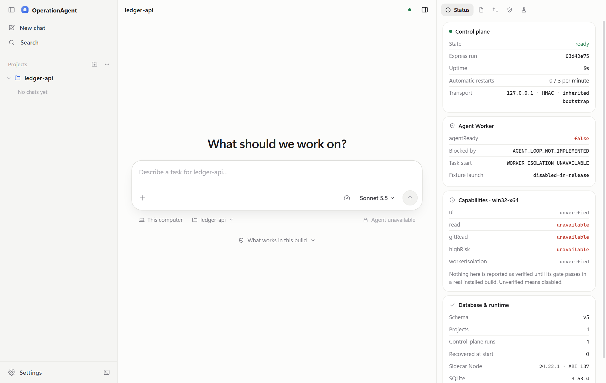
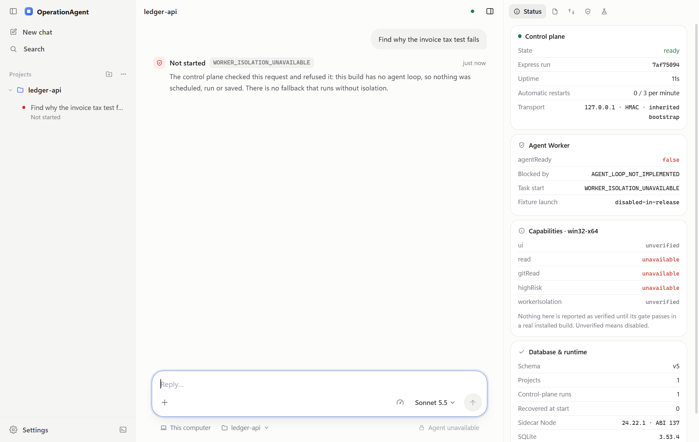
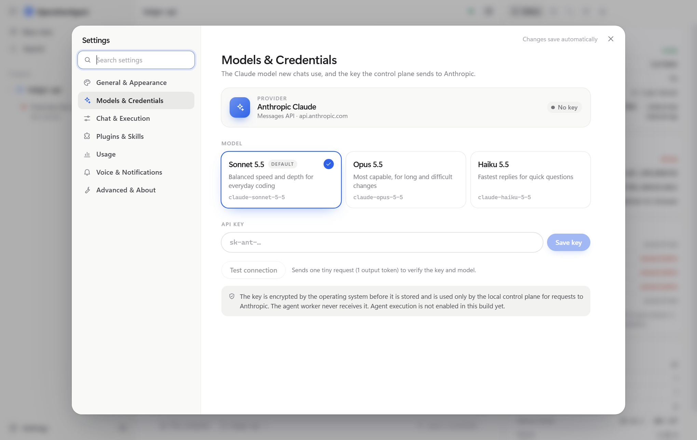
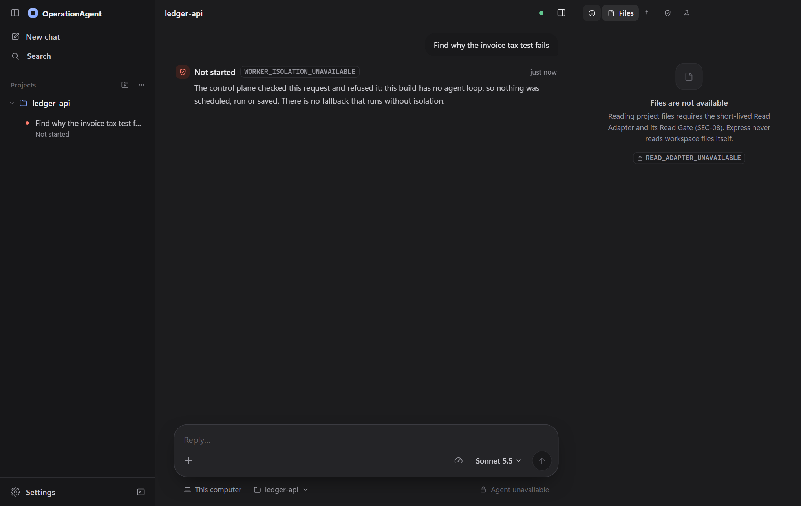
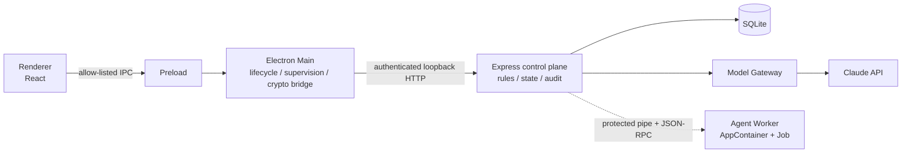

[简体中文](README.md) | **English**

# OperationAgent

OperationAgent is a **security-first** desktop AI coding agent built with Electron and TypeScript, currently targeting Windows x64.

The goal is an agent that reads code, edits files and runs commands in your project while always being treated as untrusted: the agent runs in a worker process isolated by the operating system, and every tool call is validated, authorized and audited by a control plane. If a security gate has not passed, the capability behind it stays off (fail closed); nothing ever falls back to running without isolation.

The project is delivered in gated phases, each with evidence that can be re-checked. **It is currently in milestone M2: the desktop app, control plane, persistence and model settings work, but the agent cannot run tasks yet.**



## Status

**Working now**

- An installable Windows desktop app (per-user install, no administrator rights; not code-signed yet).
- Control plane: a separate Express service process supervised by the Electron main process, with heartbeats and a bounded automatic-restart budget.
- Persistence: SQLite with versioned migrations; settings, projects and run history survive restarts.
- Projects: add, switch and remove project folders (only the path is stored; file contents are never read).
- Task infrastructure: a task state machine, an append-only task event store, snapshot and cursor-paged APIs, and the task list and event timeline in the workbench. Because execution is not enabled yet, submitted requests are refused by the control plane and no task is created.
- Claude model settings: choose a model; the API key is encrypted by the operating system (Electron `safeStorage`) before it is stored; connection test.
- Diagnostics: control-plane state, a database self-test, run history and the current state of every security capability.
- The production worker-isolation gate for Windows x64 (SEC-W01) has passed for real on a disposable CI runner.

**Not implemented yet**

- The agent loop: starting a task returns `WORKER_ISOLATION_UNAVAILABLE` and nothing runs.
- Reading project files (Read Adapter), sandboxes for file writes and shell commands, approvals, MCP.
- Process-level acceptance and SEC-W01 on macOS and Linux (currently NOT_RUN).

Anything not implemented is labelled as unavailable in the interface; the app never shows a capability it doesn't have.

| A task refused by the control plane | Model and credential settings |
| --- | --- |
|  |  |



## Progress

| Phase | Scope | Status |
| --- | --- | --- |
| P0 | Architecture review, technology choices, the Windows worker design ([ADR-WIN-001](docs/adr/ADR-WIN-001.md)) | Done |
| P1 | Desktop app, control plane, persistence, worker launcher, installer and installed-app smoke test | Done (Windows x64, see the [exit report](docs/P1-EXIT-REPORT.md)) |
| P2.0–P2.3 | Task contracts and state machine, task event store, snapshots and cursor catch-up, workbench task views | Implemented; the CI evidence for the overall P2 exit is not produced yet |
| M1 | SEC-W01: the Windows production worker-isolation gate | Done (passes on Windows x64) |
| M2 | Read-only agent: credentials, model gateway, model settings, Read Adapter, agent loop | In progress: credentials, model gateway and model settings are merged; a settings expansion is in review in [PR #10](https://github.com/JaxLim/OperationAgent/pull/10); Read Adapter and agent loop not started |
| M3 | File writes and shell: sandbox, approvals, command normalization, stop semantics | Not started |
| M4 | Productization: MCP, signing and updates | Not started |

See the [roadmap](docs/ROADMAP.md) for the plan and the [execution log](docs/EXECUTION.md) for how each change was verified.

## Technical overview



- **Desktop**: Electron 45, React 19, TypeScript 5.9, Vite. The renderer only draws the interface and has no access to Node, the file system or keys; the preload exposes a fixed allow-list of calls.
- **Control plane**: Express 5 in a separate official Node.js 24 process (not Electron's bundled Node), the only reader and writer of the database. The main process establishes the service identity over an inherited channel, then forwards API calls over HMAC-authenticated loopback HTTP.
- **Persistence**: better-sqlite3 (SQLite 3.53) with 5 versioned SQL migrations; task state and events are committed in the same transaction.
- **Contracts**: `packages/contracts` defines the API, IPC, events and error codes with zod; unit tests cover rejection of unknown fields and illegal state transitions.
- **Worker isolation (Windows)**: a native WorkerLauncher inside the control plane starts the worker in an AppContainer with a Job Object and talks to it over a single protected, inherited pipe (OWIP/1 framing + JSON-RPC 2.0).
- **Credentials**: the API key is encrypted and decrypted through the main process's `safeStorage` crypto bridge and used only by the control plane when calling Anthropic; neither the worker nor the interface ever sees it in plain text.
- **Engineering**: a pnpm workspace (3 apps + 4 shared packages); the toolchain and every dependency are pinned exactly and hash-checked; electron-builder produces an NSIS installer; GitHub Actions runs the engineering checks on three platforms, plus real-process acceptance, the installer build and an installed-app smoke test on Windows.

```
apps/
  desktop/       Electron main process, preload, React interface
  server/        Express control plane, SQL migrations, model gateway, credentials
  agent-worker/  agent worker (only a restricted test fixture so far)
packages/
  contracts/             shared zod contracts
  platform-supervision/  process supervision
  platform-worker/       native Windows worker launcher
  worker-transport/      OWIP/1 framing and sessions
scripts/         build, packaging and phase-check scripts
tests/           unit, integration, worker-fixture and installed-app tests
docs/            roadmap, acceptance criteria, execution log, ADRs and evidence
```

The full architectural constraints are in [ARCHITECTURE.md](ARCHITECTURE.md) and the development rules in [AGENTS.md](AGENTS.md).

## Install and use (Windows x64)

1. Get the installer `OperationAgent-0.1.0-win-x64.exe`: build it yourself with the `package` command below, or download the `operationagent-installer-win-x64` artifact from the latest "P1 control plane checks" run on `main` under [Actions](https://github.com/JaxLim/OperationAgent/actions) (requires a GitHub sign-in).
2. Run the installer. It isn't signed, so Windows SmartScreen may warn about an unknown publisher.
3. Start OperationAgent from the Start menu or the desktop shortcut, add a project folder, then enter your Anthropic API key under Settings → Models & Credentials and test the connection.
4. Data is stored in `%APPDATA%\OperationAgent\control-plane\control-plane.sqlite` and kept when you uninstall. To uninstall, use Windows Settings → Apps.

## Run from source (Windows x64)

Requirements: Windows 10/11 x64, Git, and any recent Node.js (only used once, to run the bootstrap script).

In PowerShell:

```powershell
git clone https://github.com/JaxLim/OperationAgent.git
cd OperationAgent

# 1. Download and verify the pinned Node.js 24.22.1 and pnpm 10.34.7 into .tools/ (nothing is installed globally)
node scripts/bootstrap-windows.mjs

# 2. Make this terminal use the pinned Node first (otherwise the engines check fails)
$env:Path = "$PWD\.tools\node;$env:Path"

# 3. Install dependencies
node .tools/pnpm/bin/pnpm.cjs install --frozen-lockfile --ignore-scripts

# 4. Build, then prepare the control-plane runtime and Electron
node .tools/pnpm/bin/pnpm.cjs build
node .tools/pnpm/bin/pnpm.cjs stage:sidecar
node .tools/pnpm/bin/pnpm.cjs prepare:electron

# 5. Start the desktop app
node .tools/pnpm/bin/pnpm.cjs desktop
```

The development build stores its data in `%APPDATA%\@operation-agent\desktop\control-plane\`. In a new terminal, repeat step 2; after changing code, run `build` and `desktop` again.

### Checks and tests

Run each command as `node .tools/pnpm/bin/pnpm.cjs <command>`:

| Command | What it does |
| --- | --- |
| `check:engineering` | Type-check, lint, module-boundary check, unit tests, build and phase-status checks, without starting real processes |
| `check` | All of the above plus real Electron / control-plane process integration tests. Building the native worker fixture needs the Visual Studio 2022 C++ build tools; the restricted fixture only runs on a disposable CI runner and is recorded as BLOCKED on your machine |
| `test` | Unit tests only |
| `test:integration` | Builds and runs the real-process integration tests |
| `package` | Builds the NSIS installer into `dist/installers/` |
| `test:smoke` | Silently installs into `.cache`, checks start, restart and recovery after a forced kill, then silently uninstalls |
| `verify:agent` | Checks M1–M4 and per-platform SEC-W01 status against the committed runner evidence |

## Documentation

These documents are written in Chinese.

- [ARCHITECTURE.md](ARCHITECTURE.md): target architecture, trust boundaries, process responsibilities and acceptance criteria
- [AGENTS.md](AGENTS.md): development rules
- [docs/ROADMAP.md](docs/ROADMAP.md): roadmap
- [docs/ACCEPTANCE.md](docs/ACCEPTANCE.md): acceptance commands and phase gates
- [docs/EXECUTION.md](docs/EXECUTION.md): how each change was carried out and verified
- [docs/P1-EXIT-REPORT.md](docs/P1-EXIT-REPORT.md): P1 exit report
- [docs/adr/](docs/adr/): architecture decisions and approval records
- Evidence: `docs/evidence/` (runner evidence for P1 and M1, M2 screenshots); phase status files: `build/*-status.json`
