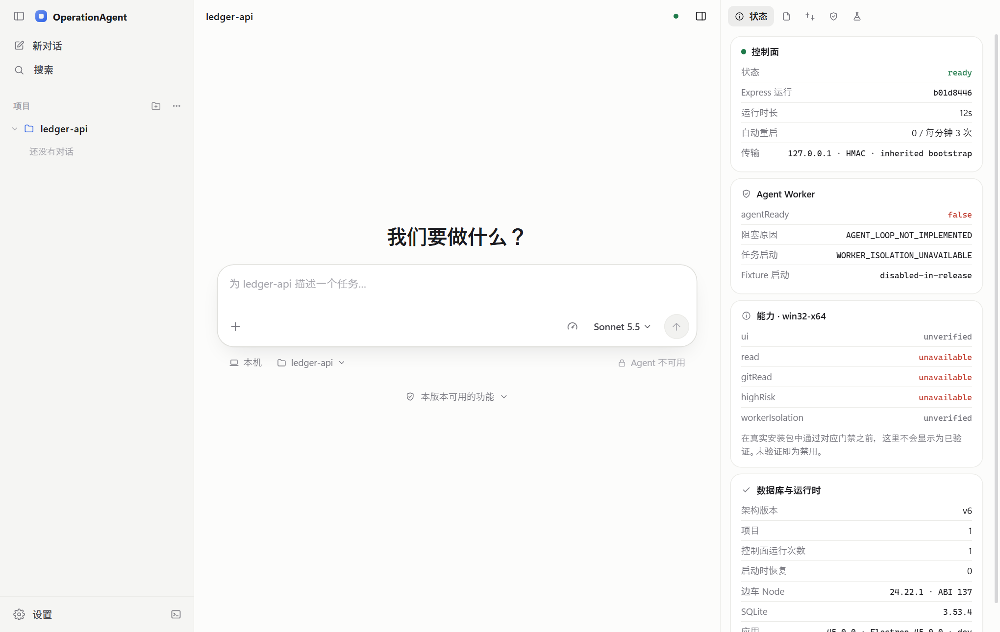
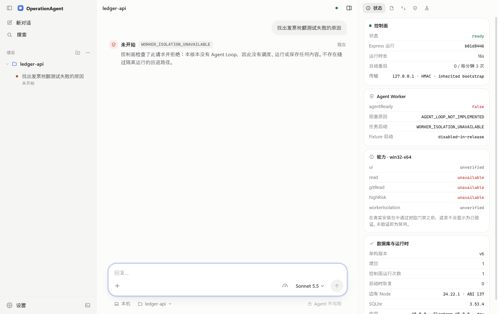
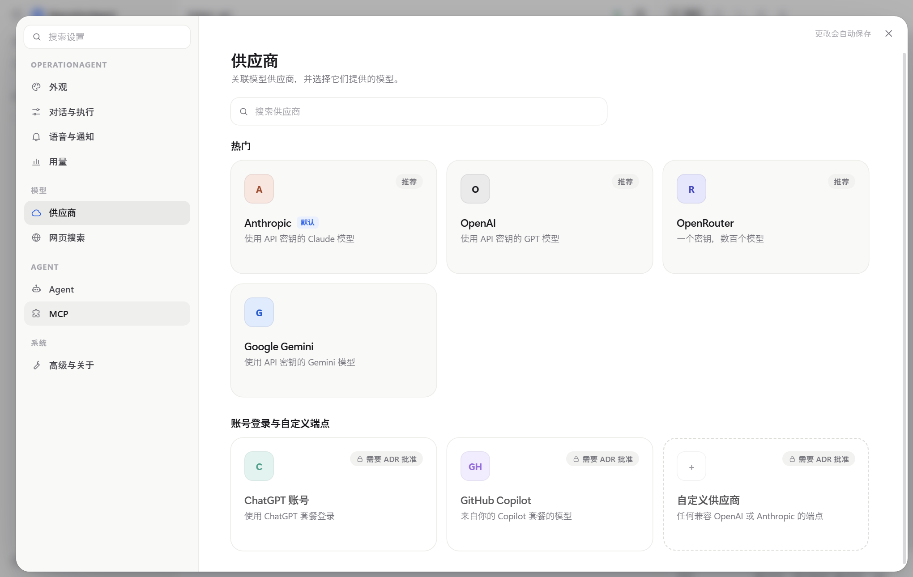
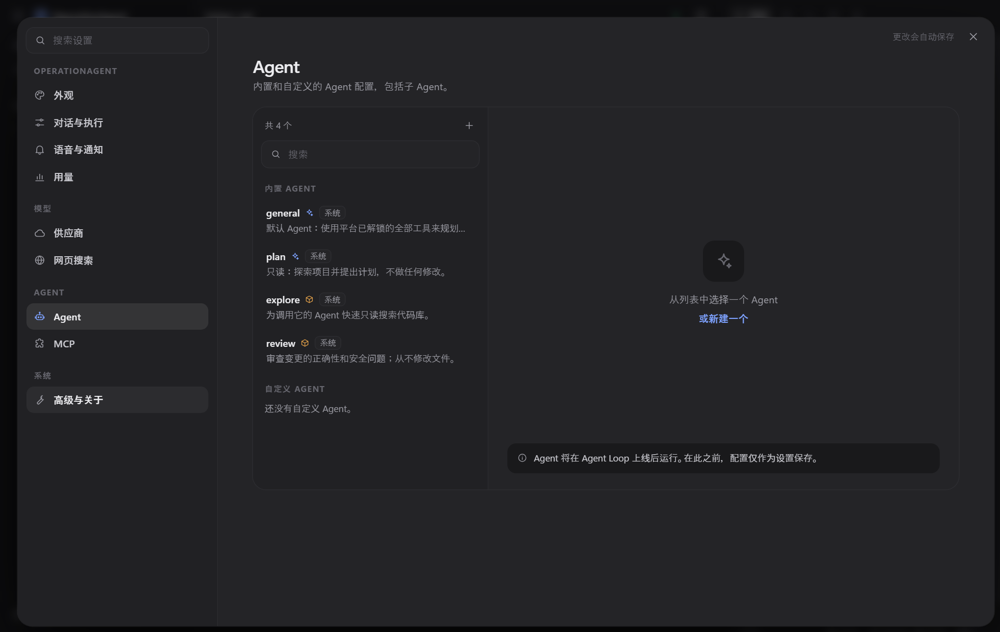
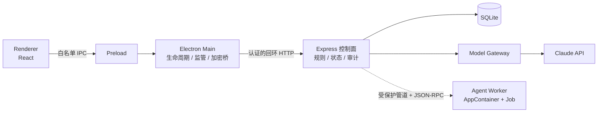

**简体中文** | [English](README.en.md)

# OperationAgent

OperationAgent 是一个**安全优先**的桌面 AI 编程 Agent，基于 Electron 和 TypeScript 开发，目前只支持 Windows x64。

目标是让 Agent 在你的项目里读代码、改文件、跑命令，但始终把它当作不可信的程序：Agent 跑在由操作系统隔离的 Worker 进程里，每次调用工具都要经过控制面的校验、授权和审计；哪道安全门禁没过，对应的能力就一直关着（fail closed），绝不会退而求其次、在没有隔离的情况下运行。

项目分阶段推进，每个阶段都留有可以复查的验收证据。**M2 阶段已完成：在 Windows x64 上，安装版应用可以运行只读 Agent，它会浏览你的项目、读取文件并回答关于项目的问题；目前还不能改文件或运行命令。**



## 当前状态

**已经能用的**

- 可安装的 Windows 桌面应用（按用户安装，不需要管理员权限；暂未做代码签名）。
- 控制面：一个独立的 Express 服务进程，由 Electron 主进程负责监管，有心跳检测，崩溃后会在限定次数内自动重启。
- 持久化：SQLite + 版本化迁移，设置、项目和运行记录重启后都还在。
- 项目管理：添加、切换、移除项目文件夹（只记路径）。
- 只读 Agent（仅 Windows x64 安装版）：针对某个项目提问，Agent 会列目录、读取文本文件，流式给出回答并标出它看过的文件，运行中可以随时停止。Agent 循环跑在由 AppContainer 隔离的 Worker 里，没有文件、网络和凭据权限；会话与 API Key 由控制面持有，文件经短生命周期的只读辅助进程读取。密钥类文件（`.env`、各类 key、`.git` 内部文件）、链接以及项目之外的路径一律拒绝。
- 每个任务的用量：任务视图显示模型回合数、输入与输出 Token、来自提示缓存的比例，以及模型与工具各自的耗时。长任务在上下文窗口将满时会请模型供应商对较早的内容做摘要，而不是直接失败（这一请求形状尚未在真实 API 上验证）。
- 任务基础设施：任务状态机、只追加的任务事件存储、快照与游标分页接口，以及工作台里的任务列表、对话和事件时间线。从源码运行的开发构建不会启动隔离 Worker，在那里提交的请求会被拒绝，不会创建任务。
- 模型供应商设置：Anthropic、OpenAI、Google Gemini、OpenRouter 均可填写 API Key、加载模型列表并测试连接；网页搜索供应商（Exa、Tavily、Brave、Firecrawl）可以保存密钥。所有密钥都先由操作系统加密（Electron `safeStorage`）再保存，数据库里只有密文。
- Agent 配置与 MCP 服务器定义：可以新建和编辑，但目前只保存配置，不会运行、启动或连接任何东西。
- 界面支持简体中文、English 和日本語；主题可选跟随系统、浅色或深色，另有八套配色。
- 诊断：查看控制面状态、做数据库自检、看运行历史，以及每项安全能力目前的状态。
- Windows x64 上的生产 Worker 隔离门禁（SEC-W01）和隔离的 Agent 运行时都已在一次性 CI runner 上实测通过（证据见 `docs/evidence/`）。

**还没实现的**

- 针对真实 Claude API 的运行记录：Agent 已在 CI runner 上对本机的模型服务替身端到端验证，但尚未对真实服务验证。第一次真实使用请视为未经测试。
- 文件内搜索、按行范围读取、计划、后续追问和技能（已规划，见 [路线图](docs/ROADMAP.md)）。
- 写文件与运行 Shell 的沙箱、审批流程、网页搜索工具、MCP Host。
- 账号登录型供应商和自定义模型端点：方案见 [ADR-PROV-001](docs/adr/ADR-PROV-001.md)（提议中，未批准），在此之前界面中保持锁定。
- macOS 和 Linux 的进程级验收与 SEC-W01（目前为 NOT_RUN）。

界面上没实现的功能都会明确标成“不可用”，不会假装能用。

| 提交任务后被控制面拒绝 | 模型供应商设置 |
| --- | --- |
|  |  |



## 进度

| 阶段 | 内容 | 状态 |
| --- | --- | --- |
| P0 | 架构评审、技术选型、Windows Worker 方案（[ADR-WIN-001](docs/adr/ADR-WIN-001.md)） | 已完成 |
| P1 | 桌面应用、控制面、持久化、Worker 启动器、安装包与安装后烟测 | 已完成（Windows x64，见 [退出报告](docs/P1-EXIT-REPORT.md)） |
| P2.0–P2.3 | 任务契约与状态机、任务事件存储、快照与游标补拉、工作台任务视图 | 已实现；P2 整体验收所需的 CI 证据还没产出 |
| M1 | SEC-W01：Windows 生产 Worker 隔离门禁 | 已完成（Windows x64 通过） |
| M2 | 只读 Agent：凭据、模型网关、模型设置、Read Adapter、Agent Loop、隔离 Worker、对话界面 | 已完成（Windows x64；runner 证据见 `docs/evidence/m2/win32-x64/`） |
| M3 | 写文件与 Shell：沙箱、审批、命令规范化、停止语义 | 未开始 |
| M4 | 产品化：MCP、签名与升级 | 未开始 |
| M5 | 平台基础（[ADR-PLAT-001](docs/adr/ADR-PLAT-001.md)）：上下文引擎与度量、选择性检索、计划 | 进行中：上下文引擎、任务用量和离线基准已实现；文件内搜索、按行读取和计划是下一步 |
| M6–M8 | 会话与检查点、技能；子 Agent 与目标驱动运行；MCP Host 与插件 | 未开始（子 Agent、无人值守续接、MCP 与插件各自需要先批准 ADR 中的具体决策） |

详细计划见 [路线图](docs/ROADMAP.md)，每次变更的验证记录见 [执行记录](docs/EXECUTION.md)。

## 技术概览



- **桌面端**：Electron 45、React 19、TypeScript 5.9、Vite。Renderer 只管界面，碰不到 Node、文件系统和密钥；Preload 只暴露一组固定的白名单接口。
- **控制面**：Express 5，跑在独立的官方 Node.js 24 进程里（不用 Electron 自带的 Node），也是唯一能读写数据库的进程。主进程先通过继承的通道确认服务身份，再经 HMAC 认证的回环 HTTP 转发 API 请求。
- **持久化**：better-sqlite3（SQLite 3.53），9 个版本化 SQL 迁移；任务状态和事件在同一事务中提交。
- **契约**：`packages/contracts` 用 zod 定义 API、IPC、事件和错误码，单元测试确保未知字段和非法的状态迁移都会被拒绝。
- **Worker 隔离（Windows）**：控制面内的原生 WorkerLauncher 以 AppContainer + Job Object 启动 Worker，通过单条受保护的继承管道通信（OWIP/1 分帧 + JSON-RPC 2.0）。
- **凭据**：API Key 的加解密都经过主进程的 `safeStorage` 加密桥，只有控制面在请求 Anthropic 时才会用到，Worker 和界面都拿不到明文。
- **工程**：pnpm workspace（3 个应用 + 4 个共享包），工具链和依赖都锁定到精确版本并校验哈希；用 electron-builder 打 NSIS 安装包；GitHub Actions 在三个平台上跑工程检查，在 Windows 上额外跑真实进程验收、安装包构建和安装后冒烟测试。

```
apps/
  desktop/       Electron 主进程、Preload、React 界面
  server/        Express 控制面、SQL 迁移、模型网关、凭据
  agent-worker/  Agent Worker（目前只有受限测试 fixture）
packages/
  contracts/             共享的 zod 契约
  platform-supervision/  进程监管
  platform-worker/       Windows 原生 Worker 启动器
  worker-transport/      OWIP/1 分帧与会话
scripts/         构建、打包、阶段检查脚本
tests/           单元、集成、Worker fixture 与安装后测试
docs/            路线图、验收标准、执行记录、ADR 与证据
```

完整的架构约束见 [ARCHITECTURE.md](ARCHITECTURE.md)，开发规范见 [AGENTS.md](AGENTS.md)。

## 安装使用（Windows x64）

1. 获取安装包 `OperationAgent-0.1.0-win-x64.exe`：按下文用 `package` 命令自行构建，或在 [Actions](https://github.com/JaxLim/OperationAgent/actions) 里 `main` 分支最近一次 “P1 control plane checks” 运行中下载 `operationagent-installer-win-x64` 产物（需要登录 GitHub）。
2. 运行安装包。安装包没有签名，Windows SmartScreen 可能会提示“未知发布者”。
3. 从开始菜单或桌面快捷方式打开 OperationAgent，添加一个项目文件夹，然后在“设置 → 供应商”里选择一个供应商（例如 Anthropic），填入 API Key 并测试连接。
4. 数据保存在 `%APPDATA%\OperationAgent\control-plane\control-plane.sqlite`，卸载后仍会保留。卸载请到 Windows“设置 → 应用”。

## 从源码运行（Windows x64）

需要准备：Windows 10/11 x64、Git，以及任意较新版本的 Node.js（只用来跑一次引导脚本）。

在 PowerShell 中执行：

```powershell
git clone https://github.com/JaxLim/OperationAgent.git
cd OperationAgent

# 1. 下载并校验锁定版本的 Node.js 24.22.1 和 pnpm 10.34.7，放到 .tools/（不做全局安装）
node scripts/bootstrap-windows.mjs

# 2. 让当前终端优先使用锁定的 Node（否则会因 engines 版本限制而失败）
$env:Path = "$PWD\.tools\node;$env:Path"

# 3. 安装依赖
node .tools/pnpm/bin/pnpm.cjs install --frozen-lockfile --ignore-scripts

# 4. 构建，准备控制面运行时和 Electron
node .tools/pnpm/bin/pnpm.cjs build
node .tools/pnpm/bin/pnpm.cjs stage:sidecar
node .tools/pnpm/bin/pnpm.cjs prepare:electron

# 5. 启动桌面应用
node .tools/pnpm/bin/pnpm.cjs desktop
```

开发版的数据在 `%APPDATA%\@operation-agent\desktop\control-plane\`。以后每开一个新终端，先重复第 2 步；改完代码后重新运行 `build` 和 `desktop` 就行。

### 检查与测试

以下命令都通过 `node .tools/pnpm/bin/pnpm.cjs <命令>` 运行：

| 命令 | 作用 |
| --- | --- |
| `check:engineering` | 类型检查、lint、模块边界检查、单元测试、构建和各阶段状态校验，不启动真实进程 |
| `check` | 在上面的基础上，再加上真实的 Electron / 控制面进程集成测试。构建原生 Worker fixture 需要 Visual Studio 2022 C++ 生成工具；受限 fixture 只在一次性 CI runner 上运行，在本机跑会记为 BLOCKED |
| `test` | 只运行单元测试 |
| `test:integration` | 构建并运行真实进程集成测试 |
| `package` | 构建 NSIS 安装包，输出到 `dist/installers/` |
| `test:smoke` | 静默安装到 `.cache`，检查启动、重启和强制结束后能否恢复，最后静默卸载 |
| `verify:agent` | 根据已提交的 runner 证据核对 M1–M4 和各平台的 SEC-W01 状态 |
| `bench:agent` | 离线基准：控制面每回合开销、只读工具调用耗时、一次脚本化任务的请求增长，以及上下文策略的成本模型（不调用真实模型） |

## 文档

以下文档均为中文。

- [ARCHITECTURE.md](ARCHITECTURE.md)：目标架构、信任边界、进程职责与验收标准
- [AGENTS.md](AGENTS.md)：开发规范
- [docs/ROADMAP.md](docs/ROADMAP.md)：路线图
- [docs/ACCEPTANCE.md](docs/ACCEPTANCE.md)：验收命令与阶段门禁
- [docs/EXECUTION.md](docs/EXECUTION.md)：每次改动的执行和验证记录
- [docs/P1-EXIT-REPORT.md](docs/P1-EXIT-REPORT.md)：P1 退出报告
- [docs/adr/](docs/adr/)：架构决策与批准记录
- 证据：`docs/evidence/`（P1、M1、M2 的 runner 证据与截图）；阶段状态文件：`build/*-status.json`
